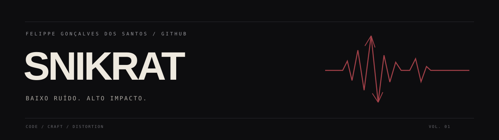

  

  <a href="https://github.com/Snikrat?tab=repositories">Projetos</a> &nbsp; / &nbsp;
  <a href="https://github.com/Snikrat?tab=stars">Referências</a>

### 01 / Identidade

Sou **Felippe Gonçalves dos Santos**, também conhecido como **Snikrat**.

Este espaço reúne código, ideias e experimentos. Minha assinatura: clareza na apresentação, personalidade nos detalhes e peso na trilha sonora.

### 02 / Frequência

**Código · criatividade · deathcore**

Gosto do contraste entre o essencial e o intenso. Aqui, isso aparece em uma estética simples, com espaço para o trabalho falar por si.

---

Precisão na forma. Distorção na assinatura.

